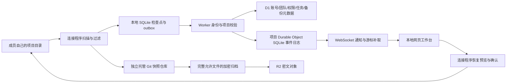

# ColloSys 源码与架构审计 · 2026-10-23

> **历史记录：以下结论描述修复前版本。** 后续已完成 A01–A10 修复及工作台补齐；当前验证结果见 [修复记录](REPAIR_2026-10-23.md) 和 [PLAN.md](../PLAN.md) 最后一节。保留本报告及原始故障证据，不把旧测试通过记录追溯解释为已覆盖这些缺陷。

**结论：当前版本未通过本轮可靠性审计。前端只是部分 Codecast 源码适配，没有移植它的完整工作台。底层具备真实实现，但存在已复现的隔离、数据完整性和状态管理缺陷。现有 Windows 包包含这些未修复问题。**

本轮没有修改产品实现，也没有重新打包、部署或购买服务。审计结果不能解释为已经修复。之前 PLAN.md 的通过记录是当时执行过的测试结果，不能推出这些测试没有覆盖的情况也可靠。

## 1. 范围、来源和证据边界

- ColloSys：检查前端状态、共享协议、文件扫描、Git 快照、SQLite/outbox、恢复、保留策略、账号/权限、DO 事件链路、备份、管理程序与安装测试。
- Codecast：获取完整仓库固定版本 `5dfb04f516122fe4f59a61137219b5a4e2e1f9f8`，重点追踪启动、布局、会话分页、同步状态、差异/消息渲染及快照实现；不是只看 README。没有运行其完整产品或上游测试，也没有声称逐行审完全部仓库。
- Delta：核对公开插件固定版本 `500bde479759fa0d62a7e525afda7b9ccd6e9a5c` 的 recording/outbox、delivery、thread commands、watch row delivery。审计的是公开插件协议实现，**不是 Delta 完整客户端 UI 或私有服务端**。公开插件源码没有集成到 ColloSys 产品。
- 故障实验均使用明确的测试数据和隔离目录/数据库。未改动用户全局 Git 配置；Git 环境变量实验只作用于当前测试进程与测试仓库。浏览器跨项目实验拦截了写请求，没有实际删除项目历史。
- 本轮保留复现脚本于 `.local/audit/`；精简结果同时保存在 `docs/audit-evidence/2026-10-23/`。脚本不属于已经纳入常规 CI 的回归测试。

上游定位：[Codecast 固定版本](https://github.com/codecast-sh/codecast/tree/5dfb04f516122fe4f59a61137219b5a4e2e1f9f8)、[Delta 公开插件固定版本](https://github.com/zed-industries/delta-claude/tree/500bde479759fa0d62a7e525afda7b9ccd6e9a5c)。下文源码路径均相对于相应仓库；ColloSys 行号对应本次审计状态。

## 2. 前端到底复用了多少

### 2.1 需要纠正的既有描述

固定版本 Codecast 的 Web 是 **React + Vite SPA + React Router**。`packages/web/tsconfig.json` 把 `next/link`、`next/navigation` 映射到 `src/compat/`。因此，上一轮用“Next 专用导航”解释不移植布局并不准确。实际耦合在 Convex API、认证、Zustand/平台状态模型、缓存与同步接口，以及桌面桥接能力。

我们实际适配的主要是 `Rail` 导航行、`ConversationHeaderBar` 标题框、`FileDiffView` 折叠文件头、统一差异解析器和部分主题 token。**本地 `Patch.tsx` 不是 Codecast 的完整差异引擎，`App.tsx:967` 的消息内容仍然只是 `<pre>`。** 三栏外形和颜色不能替代完整产品交互。

### 2.2 源码对照

| 能力                   | Codecast 已检查的实现                                                                                                           | ColloSys 当前状态                                                                      |
| ---------------------- | ------------------------------------------------------------------------------------------------------------------------------- | -------------------------------------------------------------------------------------- |
| 应用启动与页面组织     | `src/main.tsx`、`src/App.tsx`、`src/providers.tsx`；路由、认证、主题、快捷键、桌面桥接                                          | 主要集中在一个 `App.tsx`，依靠局部状态切换视图；未移植整体路由/工作台模型              |
| 持续存在的多面板工作台 | `src/layouts/DashboardShell.tsx`、`components/DashboardLayout.tsx`；布局跨页面保持，多面板、会话区、可调整尺寸                  | 自写导航/列表/详情布局；只有选定基础组件来自上游                                       |
| 会话数据与同步         | `store/inboxStore.ts`、`hooks/useSyncCore.ts`、`hooks/useSyncChangeFeed.ts`；作用域状态、缓存、待确认操作、游标追赶、按 ID 补取 | 项目级追加事件流与游标恢复真实存在；未移植会话级数据模型和状态系统                     |
| 长会话历史             | `hooks/useConversationMessages.ts`；向前/向后分页、锚点定位、实时尾部和缓存                                                     | 在最近 5,000 条项目事件中按 sessionId 分组；没有会话分页，旧会话内容会移出当前可见窗口 |
| 消息内容与工具结果     | `components/ConversationView.tsx`、`components/tools/MarkdownRenderer.tsx`；虚拟列表、结构化消息、Markdown、工具呈现            | 只采集用户与公开助手文字，用 `<pre>` 显示；无 Markdown/工具结果渲染、长列表虚拟化      |
| 会话与代码联动         | `ConversationDiffLayout.tsx`、`FileDiffLayout.tsx`；变化索引、面板、导航与会话联动                                              | 展示捕获到的事件/检查点；关联是 `observed-nearby`，不能推出某 Agent 导致某修改         |
| 差异阅读               | `DiffView.tsx`、`components/diff/pierre.ts`、`PierreDiff.tsx`；按需加载、语法与词级变化、行选择和批注接口                       | 使用上游文件头和 patch parser，但行渲染为本地简化实现；不是完整上游差异体验            |
| 评论与交接             | 上游会话、消息和差异关联状态需一并适配                                                                                          | 有真实项目/任务评论与上下文交接；没有逐消息/逐行讨论或运行中的 Agent 控制权转交        |

这里的差距既包括前端，也包括供前端使用的数据接口。只把上游页面复制过来，无法补齐消息分页、文件内容按需读取或稳定的会话引用；删掉这些依赖后留下几个标题栏，也不能称为完整复用。

### 2.3 能否直接用他们的前端

**可以复用更完整的 Codecast 核心工作台及渲染组件。当前并不存在“技术栈不同所以只能借皮肤”的理由。** 但需要在两个明确方案之间做工程选择：

1. 在现有 Cloudflare 后端上适配 Codecast 的核心阅读工作流：先定义会话、消息、文件差异、分页、成员/设备上下文等接口，再移植对应布局和组件。这保留现有本地连接程序与独立目录约束。
2. 以 Codecast 整体产品为基础 fork：同时接受其 Convex/平台状态层及运行方式，再加入我们的协作与安全边界。这是整个基础产品和后端路线的调整，不能伪装成一次换 UI。

当前建议第一条，但必须按完整工作流验收，不能再以组件数量或视觉相似作为完成标准。用户已明确排除的远程 Shell、自动合并、自动应用队友文件和远程 Agent 控制，不为了“像上游”而加入。Delta 的完整 UI 未取得可复用源码，不能承诺直接搬用。

## 3. 当前底层实际是什么



这些模块不是空接口：

- 本地保存文件后，扫描/合并更新/重扫产生真实差异。SQLite 把检查点记录与待发送事件一起持久化；Git 对象由保留引用固定。
- DO 对事件 ID 做唯一约束，同时校验相同 ID 的内容指纹；落盘后才确认。通知携带头部游标，浏览器走补取路径。它是至少一次发送加幂等持久化，不是网络“恰好一次”。
- 后端从会话查用户，再检查项目成员与工作区所有权，普通客户端填写的 actor 不能作为权威身份。
- 恢复先生成独立预览，确认时核对旧状态、保存当前状态并检查待替换文件。跨文件恢复不是文件系统事务，此前文档已经说明。
- 任务、评论、上下文交接存在真实 D1 记录与版本/接收人校验。加密归档包含允许捕获文件的完整字节，恢复到独立目录。

**架构问题主要出在边界缺乏统一的完成条件：** 扫描清单没有与 Git 实际对象逐项校验；授权检查与提交之间没有版本约束；备份的 D1 记录与 R2 对象没有同一次上传的不可混淆身份；浏览器异步结果没有全部绑定到当前项目；连接程序认证生命周期依附浏览器会话。这些问题无法通过更换 CSS 或增加一页界面解决。

## 4. 已确认问题

P1 表示进入可靠交付前必须修复的隔离、保密或完整性问题；P2 表示需要修复的时序/生命周期缺陷。严重程度不代表所有正常操作都会触发。每项都保留具体触发条件。

### A01 · P1 · Git 子进程可被继承环境导向用户原仓库

- **位置：** `packages/connector/src/vendor/codecast/git.ts:11`、`snapshots.ts:55`、`:64`，以及其他直接执行 Git 的位置。
- **原因：** `git -C <mirror>` 不会消除继承的 `GIT_DIR`、`GIT_WORK_TREE`；helper 默认沿用 `process.env`。
- **真实复现：** 将这两个环境变量指向一个隔离测试原仓库，运行快照初始化。结果原仓库出现 `ColloSys snapshot base` 提交，其已暂存文件被提交，原 index 发生变化。
- **影响：** 违反“不修改原 Git index/HEAD”的核心合同。普通启动未必携带这些变量，但不能把运行环境干净作为安全边界。
- **修复要求：** 所有 Git 执行点共用受控环境，去除仓库路由类变量；在写入前确认实际 git-dir/work-tree 属于托管状态目录；只允许明确传入托管临时 index。
- **验收：** 带继承 Git 环境的测试中，原 HEAD/index/config 都保持不变，快照仍正常工作。

### A02 · P1 · 成功检查点的清单与实际 Git 内容不一致

- **位置：** `packages/connector/src/vendor/codecast/treeSnapshot.ts:203`、`snapshots.ts:198`。
- **真实复现 1：** 通过仅作用于测试进程的 `core.excludesFile` 排除 `*.log`。扫描清单包含 `allowed.log`，Git tree 没有它，检查点仍被保存为成功。
- **真实复现 2：** 大于 64 KiB 的 `.gitignore` 被扫描器忽略，但 Git staging 仍应用其规则；同样出现清单有文件而 Git 没有内容。
- **真实复现 3：** Windows 大小写路径变化后，清单为 `upper.txt`，tree 为 `UPPER.txt`，按清单路径读取 Git 对象失败。
- **影响：** “检查点已保存”不再意味着可恢复；预览与加密归档均依赖这个读取路径。三个触发场景属于同一个未验证的数据完整性边界。
- **修复要求：** 让已授权的扫描结果成为唯一文件集合来源，隔离独立的 Git ignore/config 影响，并明确处理 Windows 大小写；发布检查点/outbox 前，校验 Git tree 的完整路径集合与内容哈希和清单一致。
- **验收：** 三种复现均能重建逐字节正确的内容；任何不一致必须拒绝发布成功检查点。

### A03 · P1 · 共享排除规则过大时静默失效

- **位置：** `packages/connector/src/files.ts:68`。
- **真实复现：** `.collosysignore` 超过 65,536 字节时被直接跳过；其中明确排除的 `private-notes.txt` 被捕获，其测试明文进入 SQLite 待发送队列。
- **证据边界：** 验证到本地 outbox，未把该测试内容上传到外部服务；结果字段 `uploadedPrivateContentInOutbox` 表示进入待发送数据，不表示已发生公网泄漏。
- **修复要求：** 存在但无法安全应用的共享策略应阻止捕获并显示原因，不能当作没有排除规则；增加不可读/无效规则处理。
- **验收：** 策略文件超限或读取失败时，相关内容不进入快照和 outbox。

### A04 · P1 · 普通 JSON 形式的凭据绕过现有脱敏

- **位置：** `packages/shared/src/protocol.ts:104`；调用链为 `files.ts:202`、`codex.ts:63`、后端 `index.ts:203`/`:205`。
- **确认结果：** 测试字符串 `{"api_key":"AUDIT_FAKE_SECRET_123456","password":"AUDIT_FAKE_PASSWORD_123456"}` 原样通过 `redact()`。属性名后的引号使现有正则失配。
- **证据边界：** 动态验证是脱敏函数；通过源码确认同一函数作用于共享 patch、Agent 文字及后端二次处理。没有使用真实凭据，也没有把实际公网泄漏列为已发生事实。
- **修复要求：** 覆盖带引号的属性名等常见形式，并加入从捕获到事件序列化的测试。路径排除仍是第一道防线，模式脱敏不能宣传为完备的密钥检测。
- **验收：** 合成敏感值在 outbox/服务端共享内容中不出现；允许文件的本地完整快照与对外脱敏视图明确区分。

### A05 · P1 · 改密码完成后，旧密码的在途登录仍能签发有效会话

- **位置：** `packages/backend/src/accounts.ts:92`、`:100`、`:118`。
- **原因：** 登录先读取旧凭据，异步验证后无条件签发 session；改密码的事务更新凭据并删掉当时已有的 session，无法覆盖之后完成的旧凭据登录。
- **复现：** 使用产品账号处理函数、隔离 SQLite 的 D1 适配器和受控响应延迟。改密码返回 200、session 数为 0 后，旧登录继续完成并返回 200，数据库存在新有效 session。
- **证据边界：** 这是生产处理逻辑的受控并发实验，不是实际异地网络攻击或已验证的公网部署行为。
- **修复要求：** 凭据版本与会话签发建立数据库级条件约束；密码变更使旧版本无法继续签发。仅在签发前追加一个独立查询仍可能留下竞态。
- **验收：** 旧密码登录跨越密码变更提交点时被拒绝；新凭据登录正常；注销和设备重连语义明确。

### A06 · P1 · 切换项目后，旧响应可改写新项目的历史保留设置

- **位置：** `packages/web/src/components/StoragePanel.tsx:43`、`:51`；`App.tsx:719`。
- **原因：** `refresh()` 没有取消/过期结果检查，面板也未按连接程序身份重新挂载，旧状态可以跨项目留存。
- **浏览器复现：** 暂缓 A 项目响应，切换 B 后显示 B 的保留数 200；释放 A 响应后，B 表单变为 2。点击保存，写请求目标是 B 连接程序，内容却是 A 的 `maxCheckpoints: 2`。
- **证据边界：** 使用真实前端与浏览器、拦截的测试接口控制时序；确认请求串用，没有在真实 B 目录执行历史删除。按错误策略清理历史是后续风险，不是本实验已做过的操作。
- **修复要求：** 状态和异步操作绑定用户/项目/连接程序上下文；废弃旧请求结果、清空项目相关选择与密码字段、当前数据未加载时禁止写入。
- **验收：** 故意倒置响应顺序，设置和写请求仍始终对应当前项目；同时覆盖备份、恢复选择和进行中的操作。

### A07 · P2 · 旧备份上传可把重建的同 ID 记录标成错误的“完成”

- **位置：** `packages/backend/src/backups.ts:70`、`:85`、`:103`。
- **真实本地 Worker 复现：** 上传尚未结束时删除预留记录，再以同一个 ID 预留不同摘要的新备份；旧上传继续完成，接口返回 `verified: true`，列表把新检查点标为 complete，但下载字节摘要是旧值。
- **原因：** 长请求使用旧记录校验，最终只按 `id` 更新完成状态，缺少上传代次和完整的条件提交。
- **边界：** 常规 UI 创建随机新 ID，实验特意覆盖 API 允许的同 ID 删除/重建；没有证明跨账号访问。客户端摘要检查应拒绝错误归档，因此这里确认的是错误成功状态/不可用备份，不是静默恢复错误文件。
- **修复要求：** 预留/上传采用不可复用代次与对象键，条件提交核对归属、摘要、大小和 pending 状态；设计中断后的 D1/R2 对账。
- **验收：** 旧上传不能完成或覆盖新预留；任何 complete 记录下载的字节摘要都与其元数据一致。

### A08 · P2 · 撤销项目权限前开始的请求仍可在撤销后发布事件

- **位置：** `packages/backend/src/index.ts:132` 先校验成员，`:192` 才等待请求体，`:206` 转交 DO；提交点未再次约束成员版本。
- **真实本地 Worker 复现：** Bob 发起未结束的事件请求；Alice 撤销权限成功，Bob 新读请求得到 403；完成原请求后仍得到 200，事件进入项目日志。
- **边界：** 新请求的鉴权和 WebSocket 权限检查确实存在。这里是撤销与在途写入的时序语义，不能描述成“后端根本没检查权限”。
- **修复要求：** 明确撤销生效点，用授权版本/序列化协议覆盖提交与发布；单独再读 D1 不等于自动获得 D1 与 DO 的跨资源原子性。
- **验收：** 撤销确认后的旧授权请求不能再提交；若选择容许既有请求完成，必须把这一产品语义明确写出，不能再宣称立即阻断所有写入。

### A09 · P2 · 选择的 Codex 日志可穿过目录 junction

- **位置：** `packages/connector/src/codex.ts:74`、`:110`。
- **真实文件系统复现：** 最后一个 JSONL 是普通文件，但其上层目录是 junction，仍被成功读取。
- **原因：** 只对最终文件执行 `lstat`，没有检查所有祖先目录。用户已选取来源并不等于满足“永不跟随链接/junction”的工程合同。
- **修复要求：** 探测、预览、采集使用统一的安全路径/文件打开逻辑，并校验路径各组成部分。
- **验收：** 祖先链接路径一律拒绝；合法授权路径正常工作。无需扫描未授权日志目录。

### A10 · P2 · 重新登录没有更新后台连接程序的会话

- **位置：** `packages/connector/src/manager.ts:166` 保存浏览器会话，`App.tsx:530` 注销它；后台发送使用 `connector.ts:160` 的旧 token。
- **复现：** 真实 manager/connector 配合本地测试认证服务。重新登录后 status 可返回 200，但新文件事件留在队列，`deliveryError` 为 `401: Session expired`，发送仍使用旧会话。
- **边界：** 已有手动“重连”操作会刷新凭据，页面也展示发送错误；不是完全无恢复路径或静默丢数据。
- **修复要求：** 直接呈现“需要重新认证”状态和重连动作，并明确浏览器会话与设备授权生命周期；如引入设备凭据，应有可撤销权限范围，不能只延长 token 有效期。
- **验收：** 注销、登录、过期、改密码之后，不会出现页面在线而用户不知道后台一直停发；恢复认证后队列去重排空。

## 5. 仍然缺少的架构能力与测试覆盖

### 5.1 活动事件模型不足以支撑完整协作工作台

当前共享协议的核心只有 `checkpoint` 与 `agent.message`，sessionId 是消息载荷字段。后端保留事件不等于前端能有效查阅任意旧会话。`api.ts:121` 仅留最后 5,000 条项目事件；`collaboration.ts:19` 起的三个列表各 `LIMIT 200`，没有对应分页读取能力。

这些限制此前部分已写在文档中，因此不是本轮新发现的数据丢失；但它们阻止我们把当前 UI 描述为完整、可持续使用的会话协作系统。应补充稳定会话/消息标识、按会话分页、任务/评论/交接分页、可引用的消息与检查点关系，以及失效/缺失状态。保留 `observed-nearby` 这种诚实归因，不能用相邻时间冒充修改因果。

### 5.2 Delta 学到了 outbox，但没实现其完整交接协议

公开插件的 `hooks/recording/outbox.ts` 对回执中的 thread、sequence、turn_sequence 做匹配，只确认连续前缀，并处理 `fenced` 轮次。`delivery.ts` 在发送前暂存记录，校验回读/摘要，持久化确认进度后才清理；`thread-commands.ts` 区分记录、重复、被旧轮次隔离等状态；`watch/row-delivery.ts` 区分界面已画出与内容已进入交付队列。

我们实现了事件唯一 ID、持久队列和确认后删除，方向正确；没有实现 Delta 的轮次所有权/执行接管协议。现在的“会话交接”是成员间的上下文交接单，接收人确认后自行继续工作。这符合当前用户选择，但不能宣传成另一个 Agent 自动接管执行现场。

### 5.3 产品运行形态需要准确表述

现有包是带本地运行时的网页工作台与连接程序，浏览器访问 loopback。连接程序只允许本地前端来源；安装版通过本地代理连接选定后端。可支持“本地 WebUI + 远端协作后端”的路线。它不是已经验证过的纯公网网站，也不是复刻了 Codecast/Delta 完整原生桌面客户端。

这不是当前授权范围内的架构错误。未来若要从公网网页直接控制本地连接程序，需要单独设计配对、来源和设备认证，不能简单放开 CORS。

### 5.4 现有测试不能覆盖本轮结论

| 本轮检查                        | 实际结果                                   | 可得出的结论                                      |
| ------------------------------- | ------------------------------------------ | ------------------------------------------------- |
| `npm run typecheck`             | 通过                                       | 当前类型检查无错误                                |
| `npm test`                      | 17/17 通过，约 14.68 秒                    | 既有单测通过；未覆盖上述故障                      |
| `npm run build`                 | 通过；两条既有 Zod annotation 提示         | 前端可构建；JS 410.09 kB / gzip 126.91 kB         |
| 连接程序隔离复现                | 7 个已确认现象，归并为 A01/A02/A03/A04/A09 | 包含 Git/文件系统实验和脱敏函数实验，详见各项边界 |
| 本地 Worker/D1/DO/R2 时序实验   | A07、A08 均复现                            | 实际本地后端行为，不是公网验证                    |
| 账号处理函数 + SQLite D1 适配器 | A05 复现                                   | 受控账号并发缺陷                                  |
| 浏览器延迟响应实验              | A06 复现                                   | 真实 UI 写请求目标/载荷串用，实际写入被拦截       |
| manager/connector 生命周期实验  | A10 复现                                   | 后台会话未随重新登录更新                          |

之前 17 项系统验收、14 项扩展验收、5 项浏览器验收的记录仍保留在 PLAN.md，本轮没有把它们冒充再次执行。安装测试直接启动 bundled Node，并未验证被自动审批阻止的 VBS/PowerShell 桌面入口。原生目录选择器、真实异地网络、生产 CPU/资源限制、线上恢复和十名真实成员仍未验证。

测试代码还存在两个明确覆盖空白：现有缓存拒权用例从无效缓存开始，没有覆盖有效的大历史缓存；安装 smoke 绕过真正桌面入口，不能据此宣称快捷方式验收通过。

## 6. 修复顺序和完成标准

1. **先恢复可信的文件/快照边界。** 修 A01–A04、A09；每次成功检查点必须能按清单完整重建，并通过真实 Windows 大小写、Git 配置、排除规则和二进制样本验证。把复现变成会失败的正式回归测试后再修改实现。
2. **把状态变更和身份生命周期闭合。** 修 A05–A08、A10；为密码版本、权限撤销、上传代次、浏览器上下文定义提交规则，以延迟/乱序/删除重建/重登实验验收。
3. **补足核心工作台的数据接口。** 按会话分页读取，稳定引用、成员/设备范围、按需差异、任务/评论/交接历史；定义真实支持的能力，未经支持的控件不显示成可用。
4. **完整适配 Codecast 的目标工作流。** 以持续布局、会话列表、消息阅读、会话/差异联动、文件导航、历史/交接为单元复用；保留必要许可证和固定上游版本，专门列出改动与未移植能力。以真实操作和长数据量检查，而非一张截图。
5. **最后重新验收与打包。** 两个独立成员目录，编辑→共享→断线补发→恢复；加入以上故障测试、长会话、跨项目切换、账号重登和安装入口测试。新包只能引用它自身实际执行过的验证结果。

不需要因为本轮缺陷就立刻换掉 React、Workers 或 SQLite。需要先修正边界与数据模型，再决定是否有充分理由整体 fork 上游。若选择第二条整体路线，要单独列出后端、部署方式、数据迁移和安全规则的变化，不能在 UI 改版里悄悄完成。

## 7. 证据索引及未证实假设

可随仓库保留的精简结果：

- `docs/audit-evidence/2026-10-23/connector.json`
- `docs/audit-evidence/2026-10-23/backend.json`
- `docs/audit-evidence/2026-10-23/password-race.json`
- `docs/audit-evidence/2026-10-23/browser-project-state.json`
- `docs/audit-evidence/2026-10-23/connector-session.json`

本机复现源与完整隔离数据：

```text
.local/audit/connector/repro.ts
.local/audit/connector/4b945365-183b-44b4-9cfe-deb2bfc8114f/results.json
.local/audit/backend/reproduce-backend-20261023.ts
.local/audit/backend/run-1792742611963/result.json
.local/audit/backend/reproduce-password-race-20261023.ts
.local/audit/backend/password-1792742697115/result.json
.local/audit/integration/browser-state.ts
.local/audit/integration/browser-state-result.json
.local/audit/integration/lifecycle.ts
.local/audit/integration/lifecycle-1792742748686/result.json
```

这些 `.local` 文件被 Git 忽略，跨电脑复现前需要保留脚本。运行脚本使用本仓库 Node/tsx；浏览器脚本需要本地前端已启动，Worker 脚本使用隔离本地资源和端口。它们不是无需准备的 CI 套件，不应把“脚本运行完”误当成“缺陷已修复”。

以下假设没有得到缺陷证据，因此不计入问题数：保留清理中断实验仍能读取原快照；删除较多文件的配额实验没有超出设定限额；项目活动流已有过期响应/去重保护，未确认同类串项目缺陷；CollaborationPanel 按项目设 key，未确认草稿串项目。跨文件快照不是同一时间的文件系统冻结，多文件恢复非原子、权限/ACL/空目录不在当前完整恢复保证内，均作为已知边界而不是本轮新发现。

本报告是一次有源码和受控实验支撑的工程审计，不是穷尽式安全认证，也不构成 Codecast 或 Delta 全产品已通过本地验证的声明。
