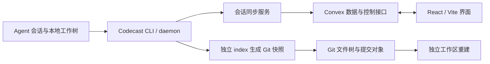
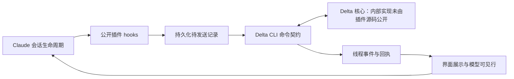

# Delta / Codecast 源码依据与 ColloSys 的取舍

本文件记录已阅读的关键调用链与实现边界，供后续调整目标时核对。它不代表完整审计过两个上游产品的所有代码，也不把公开插件等同于 Delta 的完整服务端。

**2026-10-24 当前架构说明：**下文第一版取舍及第 9 节表格保留为研究历史。当前已改为 Codecast 完整源码、实际工作台、原 store、Convex 和桌面基础，拥有的补丁位于 `integrations/codecast`，Workers/D1 是旧实现。最新源码追踪、真实缺陷及复用边界见 [特化审查](SPECIALIZATION_AUDIT_2026-10-24.md)。Delta 本地参考只有四份已保存插件源码，没有完整有效 checkout；不能把已读片段扩大成全产品审计。

固定研究版本：Codecast `5dfb04f516122fe4f59a61137219b5a4e2e1f9f8`；Delta Claude 插件 `500bde479759fa0d62a7e525afda7b9ccd6e9a5c`。这些是本次研究快照，不是对未来最新版本的承诺。

## 1. Codecast 的实际分层

源码的主要边界是 Web、CLI/daemon、Convex 后端与 shared contracts。固定版本的 Web 开发和构建脚本使用 Vite；不能因为存在 `app/` 目录就认定它使用 Next.js。仓库还有桌面、移动和云端执行相关模块，不能把整个项目理解为聊天界面加日志读取器。

- [根 package.json](https://github.com/codecast-sh/codecast/blob/5dfb04f516122fe4f59a61137219b5a4e2e1f9f8/package.json)：Bun workspace、Turbo、各包与 Convex 开发入口。
- [Web package.json](https://github.com/codecast-sh/codecast/blob/5dfb04f516122fe4f59a61137219b5a4e2e1f9f8/packages/web/package.json)：Vite、React、Convex、差异和终端等依赖。
- [Convex schema](https://github.com/codecast-sh/codecast/blob/5dfb04f516122fe4f59a61137219b5a4e2e1f9f8/packages/convex/convex/schema.ts)：users、teams、team_memberships、conversations、session_owners、daemon_commands 等实体。账号、执行设备和会话归属是不同概念。
- [syncService.ts](https://github.com/codecast-sh/codecast/blob/5dfb04f516122fe4f59a61137219b5a4e2e1f9f8/packages/cli/src/syncService.ts)：daemon 通过 Convex HTTP mutation 上传，并按需建立订阅连接。它在会话层管理写入顺序，并绕过客户端全局 mutation 队列，避免一个积压会话阻塞整个 daemon。

对 ColloSys 的含义：我们需要明确成员、设备/工作区、项目、会话之间的关系。将所有变化塞进一个全局聊天列表，会丢失归属和恢复范围。

## 2. Codecast 的文件历史是真的 Git 对象

关键入口是 [treeSnapshot.ts](https://github.com/codecast-sh/codecast/blob/5dfb04f516122fe4f59a61137219b5a4e2e1f9f8/packages/cli/src/treeSnapshot.ts#L179) 的 `createTurnSnapshot`：

1. 为工作树取得单独的快照状态目录与持久 index。
2. 通过 `GIT_INDEX_FILE` 操作这个 index，避免直接使用用户的暂存区。
3. 将变化加入 index，调用 `write-tree` 得到完整文件树。
4. 树未变化时复用已有快照；变化时通过 `commit-tree` 保存对象与父关系。
5. 保存快照 sha、tree、base、prev、branch、时间和变化路径等信息。

这提供的是可恢复的内容结构。页面上的差异文本只是其中一种视图。

该模块的历史链深度上限是 400。这个上限本身不能证明所有旧快照永久可达。因此 ColloSys 为每个保留的检查点添加自己的 Git 引用，并明确目前不自动清理历史。

## 3. 触发时机决定了它能承诺什么

[daemon.ts 的 turn snapshots 部分](https://github.com/codecast-sh/codecast/blob/5dfb04f516122fe4f59a61137219b5a4e2e1f9f8/packages/cli/src/daemon.ts#L21073) 在 Agent turn 结束后调度快照。同一工作树的多个 turn 可以合并为一次扫描；代码里还有慢扫描退避和周期 sweep。

由此可以确认：快照会包含捕获时工作树中来自人工、格式化器或 shell 的修改。但这条触发链依赖已纳入会话管理的工作区，不能直接等同于我们要求的“任意已授权项目，Agent 没启动也持续记录保存变化”。

ColloSys 因此复用对象存储部分，同时实现独立的文件监听、合并更新和定期重扫。

## 4. 历史重建与直接覆盖是两件事

[workspace/rewind.ts](https://github.com/codecast-sh/codecast/blob/5dfb04f516122fe4f59a61137219b5a4e2e1f9f8/packages/cli/src/workspace/rewind.ts) 将会话或会话行号解析到某个 turn 快照，再为工作区取得相应起点。它会检查快照对象是否存在；必要时通过 pickup 取得远端 WIP 引用。对象仍不可用时会明确拒绝，不能凭一条历史元数据重建不存在的内容。

[workspace/backends/local.ts](https://github.com/codecast-sh/codecast/blob/5dfb04f516122fe4f59a61137219b5a4e2e1f9f8/packages/cli/src/workspace/backends/local.ts) 把本地工作树生命周期封装成执行后端；读写和命令执行有具体的工作区路径。

ColloSys 第一版只需要独立预览和确认恢复，不需要复制整个远程执行、云沙箱、终端和 Agent 控制体系。当前使用预览目录，目标内容直接来自不可变 Git 对象。

## 5. 复用前必须处理的文件边界

独立 index 解决的是“不要扰乱用户暂存区”，并不会自动解决敏感内容分享。已跟踪的凭证文件不会仅因后来加入 `.gitignore` 就从 index 消失。

ColloSys 的做法是先按授权目录、路径规则、大小限制和忽略规则筛选文件，再写入独立的快照仓库；原项目的 `.git` 不被复制。托管仓库禁用外部 Git filter、换行转换和 hooks，以保留实际文件字节。

这也允许纳管尚未初始化 Git 的目录。当前测试已验证原项目 index/HEAD 不变、已跟踪 `.env` 被排除、junction 不被跟随、二进制和 CRLF 内容可恢复。

## 6. Delta 公开部分的实际边界

已阅读的是 [zed-industries/delta-claude](https://github.com/zed-industries/delta-claude/tree/500bde479759fa0d62a7e525afda7b9ccd6e9a5c) 插件。可以核对的是 Claude hook、插件自己的状态和待发送记录、与 Delta CLI 的命令契约、观看线程的事件，以及交接相关调用。Delta 核心存储、复制与服务端内部实现不在这些文件中。

[hooks/register.tsx](https://github.com/zed-industries/delta-claude/blob/500bde479759fa0d62a7e525afda7b9ccd6e9a5c/hooks/register.tsx) 注册 prompt、turn、子 Agent、会话和界面事件。它把记录与交互挂到实际 Agent 生命周期上。多数采集 hook 失败时允许开发继续；提交共享 prompt 的路径则有单独的准入处理。

这说明 Delta 的协作比“上传聊天记录”更深入：它还要知道哪一个执行轮次当前有效，以及人看到的内容和模型收到的内容是否一致。

## 7. Delta 的可靠投递链路

在 [recording/delivery.ts](https://github.com/zed-industries/delta-claude/blob/500bde479759fa0d62a7e525afda7b9ccd6e9a5c/hooks/recording/delivery.ts) 中：

- `stageOutboxRecord` 为记录分配 sequence，将不可变片段写入 outbox，再把片段列表与 digest 加入待发送状态。
- `readRecord` 重建记录并检查摘要；内容被改动时暂停分享。
- `appendPending` 形成有界批次并调用 CLI，随后核对回执。
- 清理依据已经确认并保存的状态进行；写入中断留下的孤立文件不被伪称已发送。

[recording/outbox.ts](https://github.com/zed-industries/delta-claude/blob/500bde479759fa0d62a7e525afda7b9ccd6e9a5c/hooks/recording/outbox.ts) 的 `acknowledgedPrefix` 逐条匹配 thread、sequence 和 turn association，只承认连续匹配的前缀。部分确认与失败不是一个简单成功布尔值。

[cli/delta-cli.ts](https://github.com/zed-industries/delta-claude/blob/500bde479759fa0d62a7e525afda7b9ccd6e9a5c/hooks/cli/delta-cli.ts) 调用 `thread append`，携带 source、external ID 和 producer name；支持本地确认模式，输出截断时不会假定确认成功。

ColloSys 第一版采用更小的事件协议：持久化 outbox、唯一事件 ID、服务端序号、内容一致性检查与持久化后确认。它没有实现 Delta 的完整共享执行轮次和交接契约。

## 8. Delta 的协作数据不是单一消息数组

[cli/thread-commands.ts](https://github.com/zed-industries/delta-claude/blob/500bde479759fa0d62a7e525afda7b9ccd6e9a5c/hooks/cli/thread-commands.ts) 区分本地可见性、云端分享、上传状态、producer、turn、worktree、成员在线、子线程、评论和消息增量；回执还区分 recorded、duplicate 和 fenced。

[watch/row-delivery.ts](https://github.com/zed-industries/delta-claude/blob/500bde479759fa0d62a7e525afda7b9ccd6e9a5c/hooks/watch/row-delivery.ts) 进一步区分“已经向人展示”与“已写入模型可见的会话行”，避免重复展示或把未落入会话的内容当作已经送达。

对产品取舍的影响：如果以后要做“接手队友的 Agent 会话”，必须补执行权、轮次有效性、消息可见范围、交接状态和文件工作区绑定。当前的活动流加日志适配器还不构成这项能力。

## 9. 本轮复用与不复用

| 能力                               | 本轮处理                                 | 原因                                                   |
| ---------------------------------- | ---------------------------------------- | ------------------------------------------------------ |
| Codecast Git 快照底层              | 复用固定版本，保留 MIT 声明              | 有真实对象和独立 index，边界较小                       |
| Codecast Button / Badge / 主题变量 | 选择性复用                               | 临时界面可用，避免整套产品耦合                         |
| Codecast 原 daemon 与 Convex 服务  | 未搬入                                   | 包含大量执行、账号、设备和云端功能，当前不需要整套迁移 |
| Codecast 工作区重建流程            | 研究其对象与工作区关系，另写当前恢复流程 | 当前需要目录授权、预览、备份和确认保护                 |
| Delta 投递与状态契约               | 参考公开接口与机制，不复制源码           | 插件标注 AGPL-3.0-only；当前没有引入其代码             |
| Delta 核心服务                     | 未复用、未验证内部实现                   | 公开插件不提供其完整源码                               |

实际引入文件详见 [THIRD_PARTY_NOTICES.md](../THIRD_PARTY_NOTICES.md)。本轮执行结果详见 [PLAN.md](../PLAN.md)：测试覆盖 ColloSys 的具体实现，不能作为两个上游产品全量测试或公网运行的证明。
